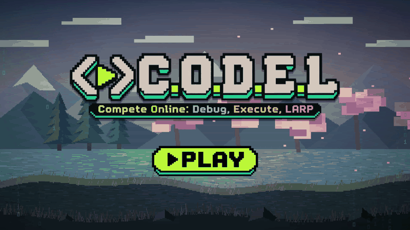

# CODEL

**Compete Online: Debug, Execute, LARP.** Real-time 1v1 coding battles with pixel-art fighters.

**Play now at [codel.space](https://codel.space)**

## How it plays

- Two players get the same question. The first correct answer attacks. Faster answers hit harder.
- A wrong answer locks you out for that round, and your opponent keeps the rest of the timer. If you both miss, you both take a small hit.
- Questions climb a concept ladder from easy to hard, and the timer gets shorter as the tier rises.
- Correct answers build a combo. When your combo reaches 3 on a round you win, that hit is an ultimate for 2.5x damage.
- The match ends on a knockout, or when the ladder is finished (time's up). The winner gets a finisher cutscene.
- Afterwards, you review every question with its correct answer and explanation, and can connect with your opponent on LinkedIn.

Play with a stranger through **Quick Match**, or with a friend: **Create Lobby** gives you a 5-character code, and they enter it in **Join Friend**.

Question types: fill in the blank, name the concept, predict the output, spot the bug, and rewrite the code.

## Fighters

Glitch, Null, Bram and Skye. Each has their own idle and attack animations, attack sounds, and a finisher against every other fighter.

## Team

| Folder | Owner | Responsibility |
|---|---|---|
| `server/src/` (except `questions/`) | **A** Multiplayer + game engine | sockets, matchmaking, lobbies, timers, battle rules |
| `client/` | **B** Interface | screens, animation, sound, cutscenes, post-match review |
| `server/src/questions/` | **C** Questions + ladder | question bank, concept ladder, answer matching |
| `shared/` | Everyone | the contract: types, socket events, constants |

Changes to `shared/` need all three owners to agree. See [docs/CONTRACT.md](docs/CONTRACT.md) for the contract and [docs/CONTRIBUTING.md](docs/CONTRIBUTING.md) for the git workflow and local setup.
